<div align="center">

[Français](README.md) · [English](README.en.md) · **العربية**

# StreamLab

<p dir="rtl"><b>إذاعات العالم كله، وقنواتك التلفزيونية، وفيديوهاتك — على هاتفك، وعلى تلفازك، وفي السيارة.</b></p>

<p dir="rtl">تطبيق أندرويد أصلي (Kotlin · Jetpack Compose · Media3)، بلا حساب، بلا إعلانات، بلا تتبّع.</p>


<p><a href="https://github.com/projetperso78/StreamLab/releases/latest"><b>⬇️ تنزيل نسخة الركاب (APK)</b></a></p>

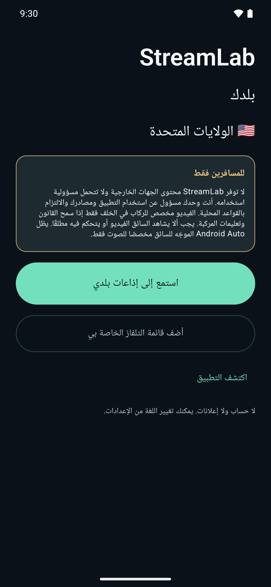
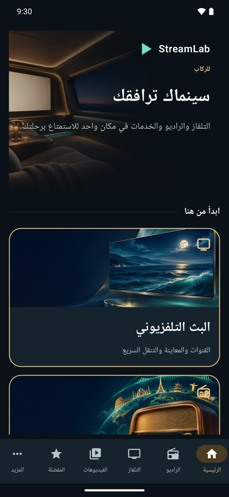
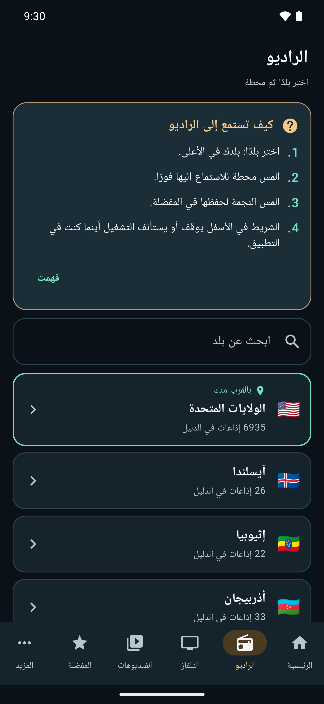
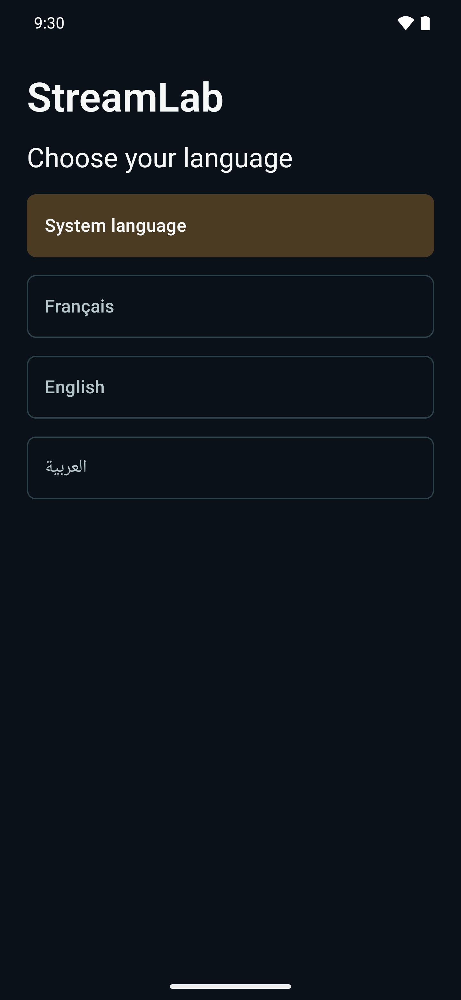

<p dir="rtl"><sub>التطبيق متوفر بالكامل باللغة العربية ومن اليمين إلى اليسار. بعض الصور أدناه تعرض الواجهة الفرنسية.</sub></p>

</div>

<div dir="rtl">

---

## لماذا StreamLab؟

معظم مشغّلات IPTV والراديو إمّا معقّدة جدًا، وإمّا مليئة بالإعلانات وأدوات التتبّع.
يختار StreamLab العكس: **تطبيق واحد واضح** للاستماع إلى إذاعات أي بلد،
ومشاهدة قنواتك وفيديوهاتك **الخاصة**، والاستمتاع بكل ذلك **في السيارة** — دون إنشاء حساب،
ودون أن يغادر أي شيء هاتفك.

> لا يوفّر StreamLab **أي قناة ولا أي محتوى**. أنت من يضيف مصادره (قوائم M3U، مزوّد Xtream،
> دليل XMLTV، قرص الشبكة المنزلي) وتبقى مسؤولًا عن امتلاك حق استخدامها.
> تأتي الإذاعات من الدليل العام والمفتوح [Radio Browser](https://www.radio-browser.info).

---

## نسختان

> **StreamLab للركاب = التطبيق القانوني كاملًا + شاشة السيارة.**
> الشيفرة نفسها، والميزات نفسها، والإعدادات واللغات نفسها الموجودة في نسخة Google Play،
> مع شاشة كاملة إضافية في السيارة أثناء التوقّف. شيفرة النسختين موجودة في هذا المستودع
> (`app/src/main` للتطبيق المشترك، و`app/src/parkedDebug` لشاشة السيارة).

| | **StreamLab** (Google Play) | **StreamLab للركاب** (نسخة شخصية) |
|---|---|---|
| التطبيق كاملًا: راديو، تلفاز، عرض متعدد، فيديوهات، قرص الشبكة، Cast، المفضلة، المنبّه… | ✅ | ✅ مطابق |
| أندرويد أوتو — الراديو وصوت القنوات (شاشة الوسائط) | ✅ | ✅ |
| يعمل وحده (دون الحاجة إلى تطبيق آخر) | ✅ | ✅ |
| أندرويد أوتو — **الفيديو أثناء التوقّف** | — | ✅ |
| أثناء القيادة | الصوت فقط | يُغلق أندرويد أوتو الصورة، **ويستمر الصوت** |
| عند التوقّف من جديد | — | **تعود القناة نفسها بملء الشاشة** |
| إبقاء شاشة السيارة مضاءة (خيار) | — | ✅ |
| التوزيع | Google Play — *قريبًا* | غير موزّعة في المتاجر |

يعتمد الفيديو على شاشة السيارة على الفئة الرسمية **«تطبيقات أثناء التوقّف»** في أندرويد أوتو
(أندرويد 15 فما فوق): أندرويد أوتو نفسه هو من يُغلق الصورة بمجرد تحرّك السيارة.
لا يتم تجاوز أي قاعدة من قواعد السلامة أثناء القيادة.

> 📲 **Google Play**: النسخة العامة قادمة قريبًا، وسيُضاف الرابط هنا.

---

## ماذا يفعل StreamLab، من الألف إلى الياء

### 📻 الراديو
- **كل إذاعات العالم مرتّبة حسب البلد** — أكثر من 40,000 محطة (دليل Radio Browser)، مع الأعلام وعدد المحطات.
- **«بالقرب منك»**: يظهر بلدك أولًا (يُكتشف على الجهاز، **دون GPS ودون إذن الموقع**).
- **«الأكثر إعجابًا»** و**«الرائج»** في كل بلد، مع بحث فوري.
- **أسماء نظيفة**: «RADIO-XYZ 128k AAC (geo-blocked)» تصبح «Radio XYZ»؛ دمج المكرّرات؛ أنواع موسيقية مقروءة.
- **عرض الأغنية الحالية** (الفنان – العنوان) عندما ترسلها المحطة.
- **المفضلة بلمسة واحدة** (النجمة)، و**«استمع إلى إذاعاتي بلا توقّف»**: تتوالى محطاتك المفضلة كقائمة تشغيل.
- **مصادر احتياطية**: إذا توقّفت محطة، يجرّب StreamLab تلقائيًا حتى **3 عناوين** قبل الانتقال إلى التالية.
- **لا إعلانات متكرّرة**: لم يعد المشغّل يقطع البث الطويل (لم يعد إعلان البداية يتكرّر كل 30 ثانية).
- **منبّه الراديو**: في الوقت الذي تختاره، مرة واحدة، أو أيام الأسبوع، أو كل يوم، مع محطتك المفضلة.
- **التحكم الصوتي**: «Ok Google, play RTL» يجد أفضل تطابق، حتى لو لم تكن المحطة في مفضلتك.

<p align="center">
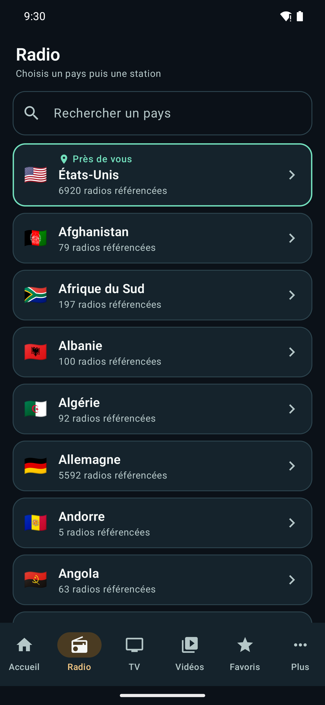
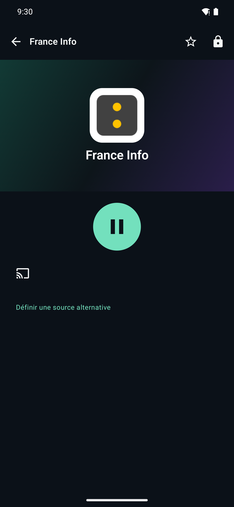
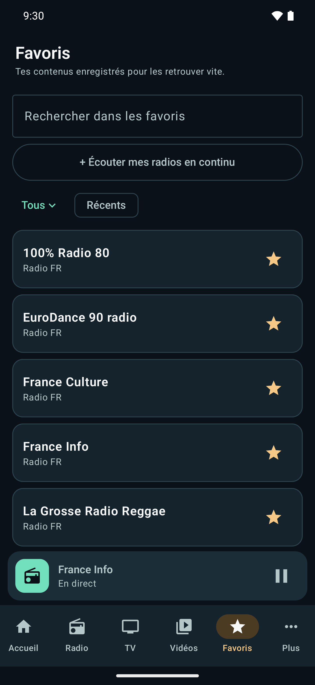
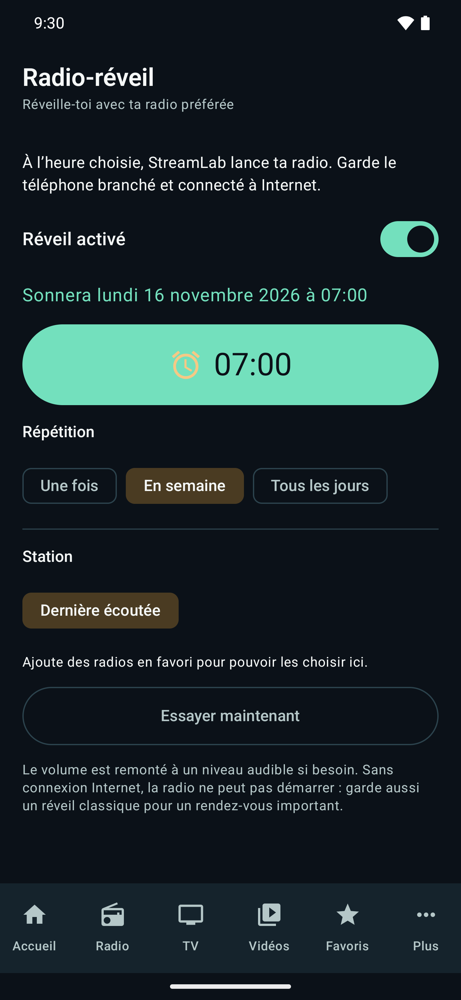
</p>
<p align="center"><sub>المحطات حسب البلد · التشغيل · المفضلة (مع المشغّل المصغّر في الأسفل) · منبّه الراديو</sub></p>

### 📺 التلفاز
- **قنواتك مرتّبة حسب البلد واللغة** — يقرأ الترتيب مصدر البث («@FR») قبل اسم المالك، ولا يخلط بين «SD/HD» واسم بلد.
- **مشغّل بملء الشاشة** مع شريط «مباشر»، و**البرنامج الحالي / التالي** (دليل XMLTV)، والتنقّل بين القنوات بالسحب، وقائمة القنوات.
- **فحص القنوات**: زر واحد يختبر البث ويشير إلى القنوات التي لا تستجيب.
- **العرض المتعدد**: **من 2 إلى 4 قنوات في الوقت نفسه** على شكل فسيفساء، والصوت على القناة التي تختارها.
- **صورة داخل صورة (PiP)**: يستمر التلفاز في نافذة صغيرة عند مغادرة التطبيق.
- **سرعة التشغيل** (من 0.75× إلى 2×) للفيديوهات.
- **إضافة قنواتك**: قائمة M3U (رابط أو ملف)، مزوّد Xtream Codes، قناة واحدة، دليل XMLTV.
- **مصادر احتياطية** لكل قناة، كما في الراديو.

<p align="center">
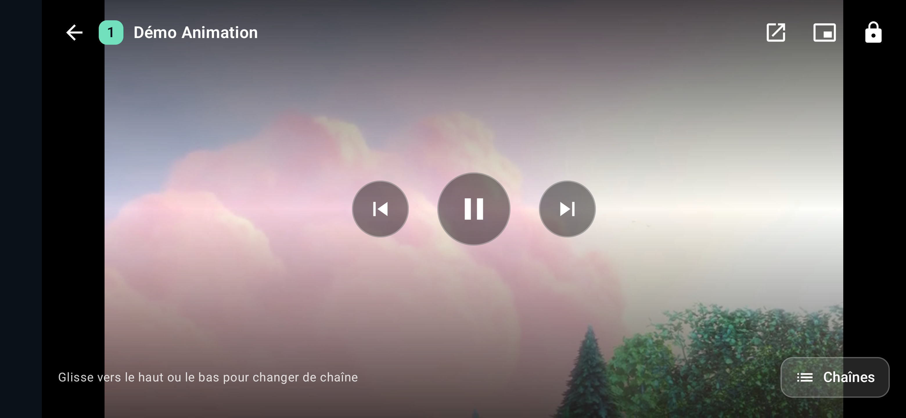
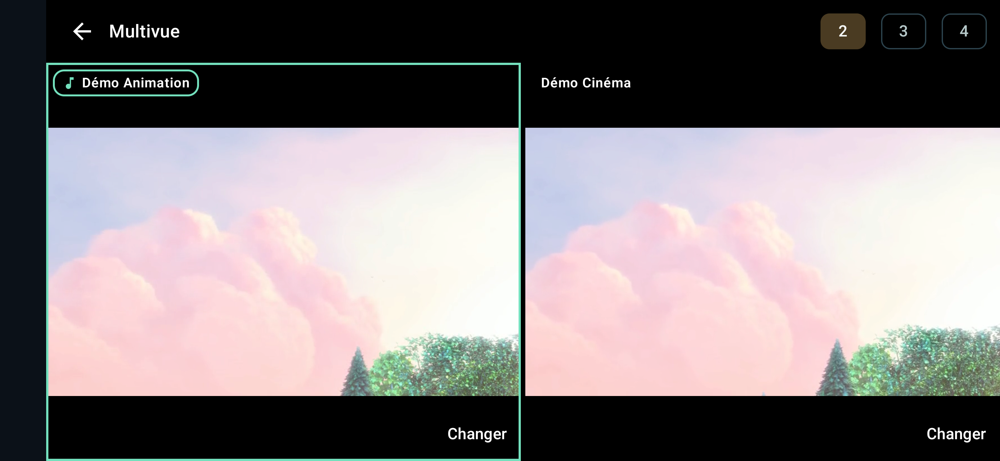
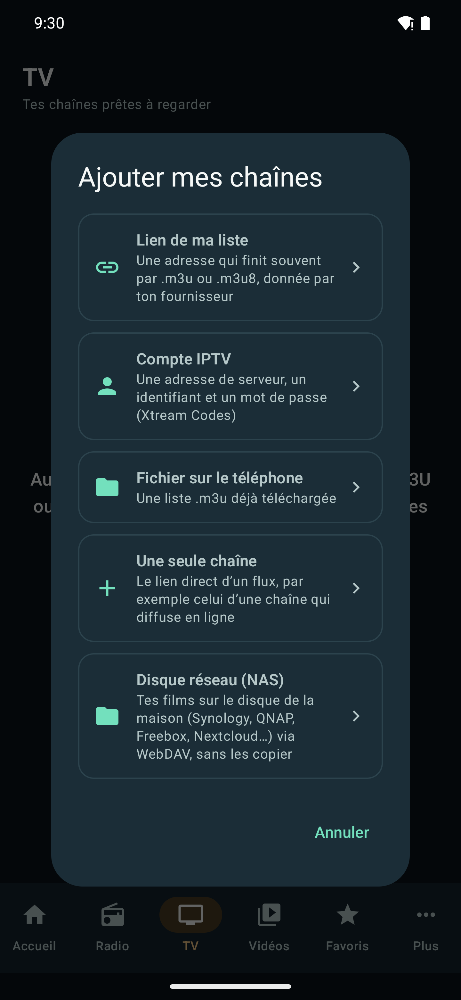
</p>
<p align="center"><sub>ملء الشاشة · العرض المتعدد · إضافة القنوات. صور العرض مأخوذة من الفيلم الحر <i>Big Buck Bunny</i> (CC BY 3.0).</sub></p>

### 🎬 الفيديوهات وقرص الشبكة
- **قرص الشبكة في المنزل (WebDAV)**: Synology وQNAP وFreebox وNextcloud… تصفّح مجلداتك وشغّل فيلمًا **دون نسخه** إلى الهاتف.
- **ملفات الهاتف** و**«متابعة المشاهدة»** من النقطة نفسها التي توقّفت عندها.
- **الفتح في مشغّل آخر** (VLC، MX Player…) بلمسة واحدة.

<p align="center">
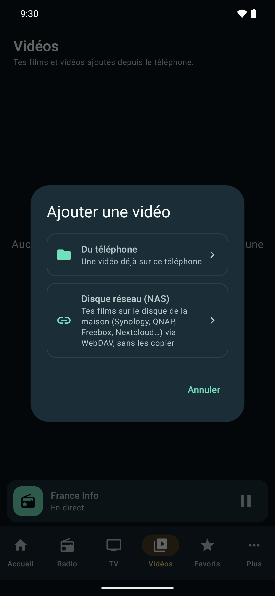
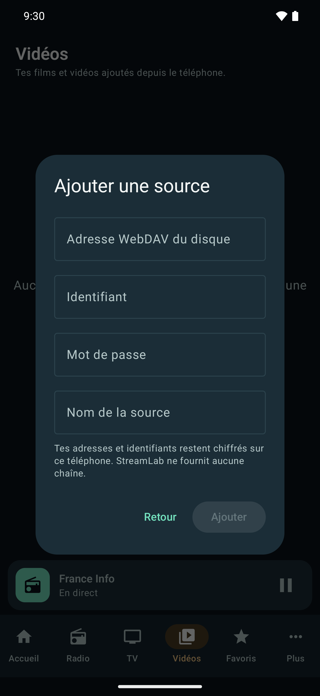
</p>
<p align="center"><sub>الاختيار بين الهاتف وقرص الشبكة · بيانات الدخول مشفّرة على الجهاز</sub></p>

### 📡 على تلفاز غرفة المعيشة
- **Google Cast**: أرسل الراديو أو قناة أو فيديو من الهاتف إلى تلفازك / Chromecast.
- تُقدَّم الفيديوهات المخزّنة على الهاتف محليًا، محميّة برمز يُستخدم مرة واحدة.

### 🚗 أندرويد أوتو
- قائمة واضحة أثناء القيادة: **الراديو حسب البلد، المفضلة، الأخيرة، التلفاز، المصادر**.
- **المحطة التالية / السابقة** من المقود، والتحكم الصوتي، والصور والشعارات.
- رسائل خطأ قصيرة ومقروءة (دون رموز تقنية على الشاشة أبدًا).
- نسخة الركاب: الفيديو أثناء التوقّف، والصوت فقط أثناء القيادة، والعودة التلقائية إلى ملء الشاشة عند التوقّف (انظر أدناه).

### 🧭 ميزات عملية
- **المفضلة** و**الأخيرة** في كل مكان.
- **شارك مع صديق**: إذاعاتك المفضلة وقوائمك عبر **رمز QR** (دون أي اسم مستخدم أو كلمة مرور في الرمز أبدًا).
- **وضع الأطفال**: يقتصر التطبيق على مفضلتك، ومحميّ برمز الوالدين.
- **توفير البيانات**: على شبكة 4G/5G ينتقل الفيديو إلى 480p (نحو ثلث البيانات)؛ وبأعلى جودة على Wi-Fi.
- **وضع عدم الاتصال** واضح: رسالة بسيطة بدل شاشة خطأ.
- **نصائح عند أول تشغيل**، خفيفة، تظهر مرة واحدة.
- **خدمات الويب**: اختصارات إلى التطبيقات الرسمية (Netflix، YouTube، Prime Video، Disney+، Twitch، Plex، Jellyfin، Emby). لا **يدمج** StreamLab مشغّلاتها **ولا يتجاوز** حمايتها.

<p align="center">
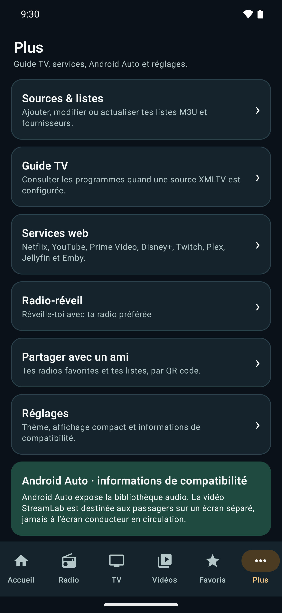
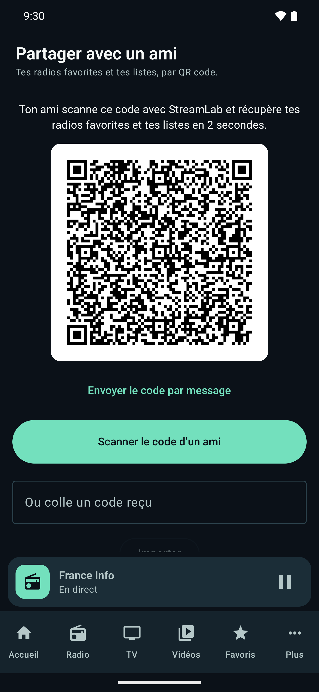
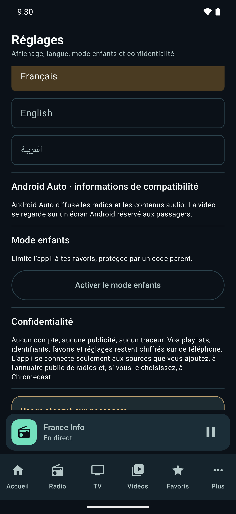
</p>
<p align="center"><sub>قائمة «المزيد» · المشاركة عبر رمز QR · وضع الأطفال والخصوصية</sub></p>

### 🎨 الواجهة واللغات
- سمة **سينما** الداكنة، أو **فاتحة**، أو **حسب النظام**؛ مع قائمة مضغوطة اختيارية.
- أيقونات متّجهة واضحة، وشعارات المحطات، وحروف أولى أنيقة عندما لا يكون للمحطة شعار.
- **ثلاث لغات كاملة**: الفرنسية والإنجليزية و**العربية (من اليمين إلى اليسار)** — أو لغة النظام. تختارها عند أول تشغيل ويمكنك تغييرها في أي وقت من الإعدادات.
- إمكانية الوصول: أوصاف لقارئات الشاشة، ومساحات لمس كبيرة.

<p align="center">
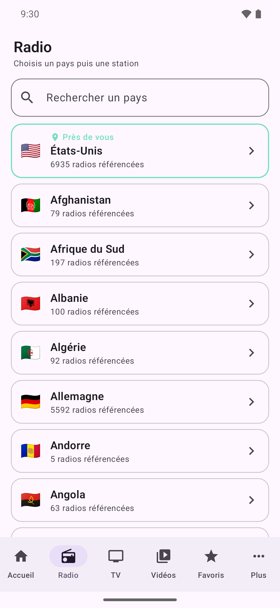
</p>
<p align="center"><sub>السمة الفاتحة</sub></p>

---

## أندرويد أوتو (Android Auto)

### نسخة Google Play
لا شيء عليك فعله: صِل هاتفك، فيظهر StreamLab ضمن تطبيقات الوسائط في أندرويد أوتو.

### نسخة الركاب (الفيديو أثناء التوقّف)
المتطلبات: **أندرويد 15 فما فوق** وشاشة لمس في السيارة.

1. ثبّت ملف `parkedDebug` APK (يظهر باسم **StreamLab Passagers**). إنه التطبيق الكامل: لا حاجة لتثبيت نسخة Play أيضًا.
2. على الهاتف: **Android Auto ← الإعدادات** ← المس **«الإصدار»** 10 مرات لتفعيل وضع المطوّر.
3. القائمة ⋮ ← **إعدادات المطوّرين** ← فعّل **«مصادر غير معروفة»**.
4. أعد توصيل الهاتف: يظهر التطبيق في مشغّل تطبيقات السيارة.

**أثناء التوقّف** تُعرض القناة بملء الشاشة؛ **أثناء القيادة** يُغلق أندرويد أوتو الصورة **ويستمر الصوت**
(مع أزرار التحكم على شاشة الوسائط وعلى المقود)؛ **وعند التوقّف من جديد** تعود القناة نفسها بملء الشاشة.
في إعدادات شاشة السيارة، يمنع خيار **«إبقاء الشاشة مضاءة»** انطفاء الشاشة أثناء الفيديو.

<p align="center">
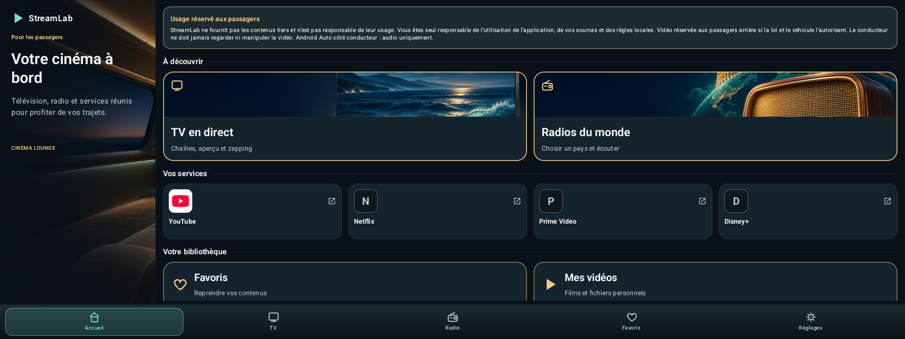
</p>
<p align="center">
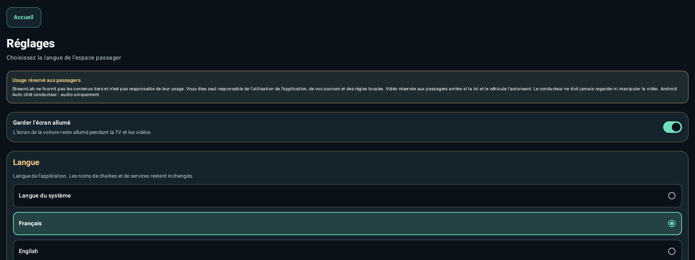
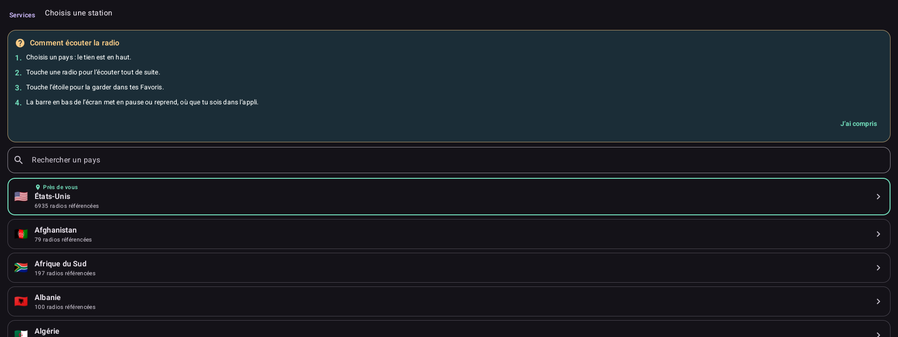
</p>
<p align="center"><sub>شاشة السيارة في StreamLab للركاب: الرئيسية، الإعدادات («إبقاء الشاشة مضاءة»)، الراديو.
التُقطت على شاشة ثانوية بدقة 1920×720 في محاكي أندرويد، تحاكي شاشة السيارة.</sub></p>

---

## التثبيت

**Google Play** — *قريبًا*.

**StreamLab للركاب (APK)** — التطبيق الكامل + شاشة السيارة: [⬇️ تنزيل أحدث إصدار](https://github.com/projetperso78/StreamLab/releases/latest).
افتح الملف على هاتفك لتثبيته، ثم اتّبع خطوات قسم أندرويد أوتو لشاشة السيارة.

**من الشيفرة المصدرية** (JDK 17، Android SDK 36):

</div>

```bash
./gradlew :app:assembleDebug          # النسخة العادية
./gradlew :app:assembleParkedDebug    # نسخة الركاب (الفيديو أثناء التوقّف)
```

<div dir="rtl">

لا يحتوي هذا المستودع على أي مفتاح أو سرّ: يُقرأ توقيع النشر فقط من متغيرات البيئة.

---

## الجودة

- **البنية**: Kotlin وJetpack Compose وMedia3 (ExoPlayer، `MediaLibraryService`، `MediaController`) وRoom وOkHttp.
- **الاختبارات**: 132 اختبار وحدة و90 اختبارًا على الجهاز (التنقّل، التشغيل، أندرويد أوتو، Cast، العرض المتعدد، قرص الشبكة، الراديو، المصادر الاحتياطية…).
- **المتانة**: أكثر من 75,000 إجراء عشوائي (اختبار الضغط *monkey*) على نسختي debug وrelease، دون أي تعطّل.
- **نسخة النشر**: شيفرة مصغّرة ومموّهة (R8)، وفحص lint دون أخطاء على جميع النسخ.
- **الأمان**:
  - المصادر وبيانات الدخول **مشفّرة على الجهاز** (Android Keystore، AES-GCM)؛
  - الاتصال عبر **HTTPS**؛ تُرفض عناوين الشبكة المحلية باستثناء قرص الشبكة الذي أضفته؛
  - معالجة WebDAV محصّنة (رفض DTD والكيانات)؛
  - لا بيانات دخول في السجلات؛
  - النسخ الاحتياطي لبيانات أندرويد معطّل.

---

## الخصوصية

- **لا حساب**، **لا إعلانات**، **لا أدوات لقياس الجمهور**.
- قوائمك ومفضلتك وسجلّك وإعداداتك **تبقى على هاتفك**.
- اتصالات الشبكة تقتصر على: المصادر التي تضيفها، ودليل Radio Browser، وGoogle Cast، وماسح QR من خدمات Google Play (فقط عند استخدامها).

السياسة الكاملة (بالفرنسية والإنجليزية): [docs/play/POLITIQUE_CONFIDENTIALITE.md](docs/play/POLITIQUE_CONFIDENTIALITE.md).

---

## الترخيص والملكية

© 2026 Younes Ajbilou — **جميع الحقوق محفوظة.**

✅ **مسموح**: الاطّلاع على هذا المستودع، وتنزيله، وبناؤه، وتثبيت التطبيق على أجهزتك الخاصة،
للاستخدام **الشخصي والخاص وغير التجاري**.

⛔ **ممنوع دون إذن كتابي**: إعادة توزيع التطبيق أو نشره (أو نسخة معدّلة منه)، بما في ذلك في متاجر التطبيقات،
أو بيعه، أو إعادة استخدام الشيفرة أو اسم **StreamLab** أو الأيقونة أو الواجهة أو الصور في مشروع آخر،
أو استخدام هذا المستودع لتدريب ذكاء اصطناعي. هذا ليس ترخيصًا مفتوح المصدر.

> ⚠️ **إخلاء المسؤولية.** يُقدَّم التطبيق **«كما هو»، دون أي ضمان**.
> إذا قمت بتنزيله أو بنائه أو تثبيته أو استخدامه، فأنت تفعل ذلك **على مسؤوليتك الخاصة وحدك**.
> وإلى أقصى حدّ يسمح به القانون، **لا يتحمّل المؤلف أي مسؤولية على الإطلاق عمّا تفعله به** ولا عن عواقبه:
> المصادر والمحتوى الذي تضيفه ومدى قانونيته، والاستخدام في السيارة (السائق وحده مسؤول عن قيادته؛
> نسخة الركاب مخصّصة للركاب وللسيارة المتوقّفة فقط)، وأي ضرر أو فقدان للبيانات أو رسوم بيانات الجوال،
> أو أي نسخة يعدّلها طرف آخر.

راجع [LICENSE](LICENSE) و[NOTICE](NOTICE.md). في حال وجود اختلاف بين الترجمات، يُعتمد نص ملف LICENSE.

أسماء وشعارات الخدمات الأخرى (Netflix، YouTube، Prime Video، Disney+، Android Auto، Google Cast…)
مملوكة لأصحابها. StreamLab غير تابع لأي منها.

للتواصل: contactstreamlab@gmail.com

</div>
