<div align="center">

[Français](README.md) · **English** · [العربية](README.ar.md)

# StreamLab

**World radio, your own TV channels and your videos — on your phone, on your TV and in the car.**

Native Android app (Kotlin · Jetpack Compose · Media3). No account, no ads, no tracking.


<a href="https://github.com/projetperso78/StreamLab/releases/latest"><b>⬇️ Download Passengers (APK)</b></a> ·
<a href="#install">Install</a> ·
<a href="#what-streamlab-does-from-a-to-z">Features</a> ·
<a href="#android-auto">Android Auto</a> ·
<a href="#privacy">Privacy</a> ·
<a href="#licence-and-ownership">Licence</a>

<br>

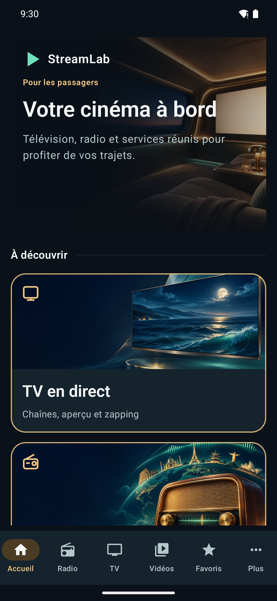
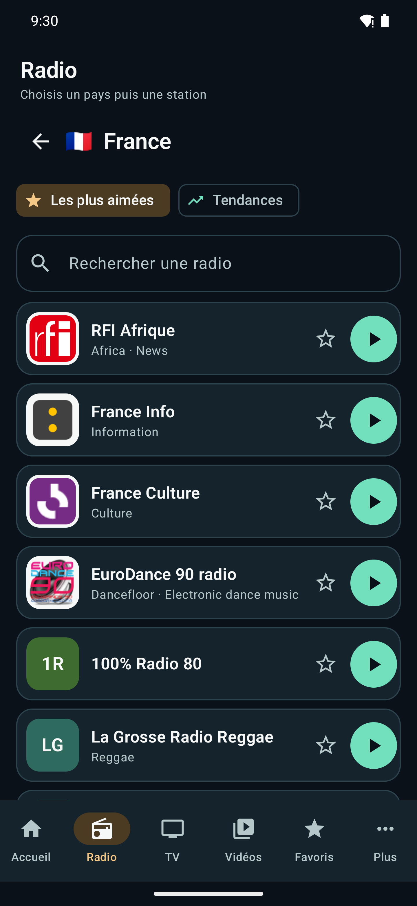
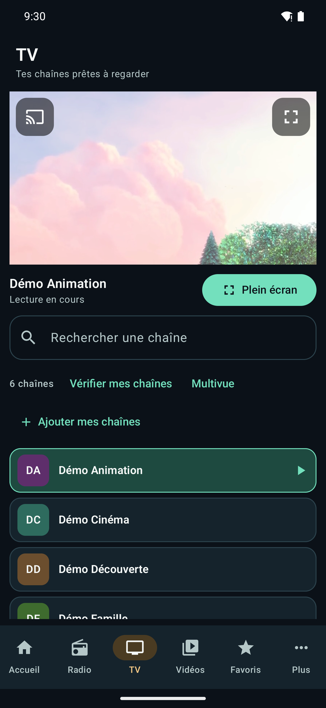
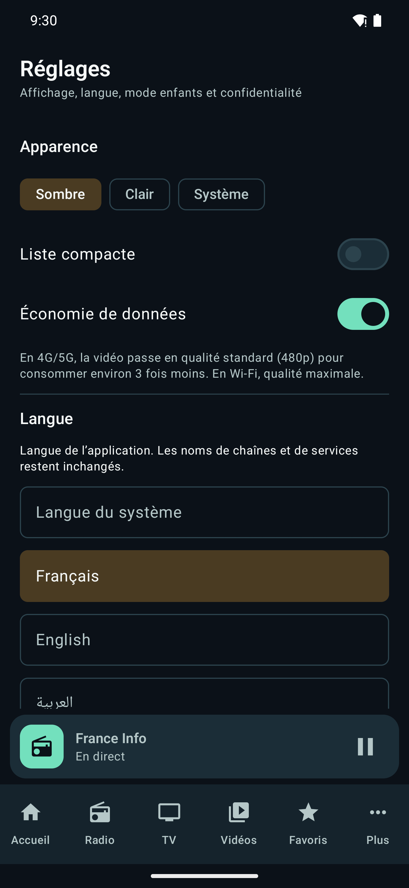

<sub>Most screenshots show the French interface. The app is fully available in English and Arabic.</sub>

</div>

---

## Why StreamLab?

Most IPTV and radio players are either overcomplicated or full of ads and trackers.
StreamLab does the opposite: **one clear app** to listen to radio from any country,
watch **your own** channels and videos, and take all of it **into the car** — with no account
and nothing leaving your phone.

> StreamLab **provides no channels and no content**. You add your own sources (M3U playlists,
> Xtream provider, XMLTV guide, network drive) and you remain responsible for having the right to use them.
> Radio stations come from the free and open [Radio Browser](https://www.radio-browser.info) directory.

---

## Two editions

> **StreamLab Passengers = the whole lawful app + the car screen.**
> Same code, same features, same settings and same languages as the Google Play edition,
> plus a full-size screen in the car while parked. The code of both editions is in this repository
> (`app/src/main` for the shared app, `app/src/parkedDebug` for the car screen).

| | **StreamLab** (Google Play) | **StreamLab Passengers** (personal edition) |
|---|---|---|
| The whole app: radio, TV, multiview, videos, network drive, Cast, favourites, alarm… | ✅ | ✅ identical |
| Android Auto — radio and channel sound (media screen) | ✅ | the current sound goes on, no lists |
| Installs on its own (no other app needed) | ✅ | ✅ |
| Android Auto — **video while parked** | — | ✅ |
| While driving | audio only | Android Auto closes the picture, **the sound goes on** |
| Parked again | — | **the same channel comes back full screen** |
| Keep the car screen on (option) | — | ✅ |
| Distribution | Google Play — *coming soon* | not distributed on app stores |

Video on the car screen relies on Android Auto's official **"parked apps"** category
(Android 15 and later): Android Auto itself closes the picture as soon as the car moves.
No driving-safety rule is bypassed.

> 📲 **Google Play**: the public version is coming soon. The link will be added here.

---

## What StreamLab does, from A to Z

### 📻 Radio
- **Every radio station in the world, sorted by country** — more than 40,000 stations (Radio Browser directory), with flags and station counts.
- **"Near you"**: your country comes first (detected on the device, **no GPS and no location permission**).
- **"Most loved"** and **"Trending"** in every country, instant search.
- **Clean names**: "RADIO-XYZ 128k AAC (geo-blocked)" becomes "Radio XYZ"; duplicates merged; readable genres.
- **Song on air** (artist – title) when the station sends it.
- **One-tap favourites** (star), and **"Play my stations non-stop"**: your favourites play one after another like a playlist.
- **Backup sources**: if a station goes down, StreamLab automatically tries up to **3 addresses** before moving on.
- **No looping ads**: the player no longer cuts long streams (the opening ad no longer comes back every 30 s).
- **Radio alarm**: at the time you choose, once, on weekdays or every day, with your favourite station.
- **Voice control**: "Ok Google, play RTL" finds the best match, even if it is not in your favourites.

<p align="center">
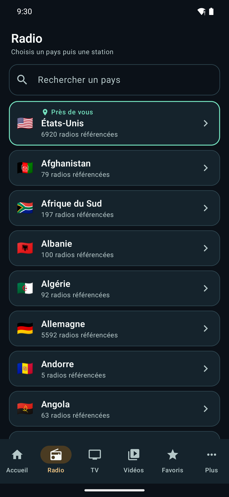
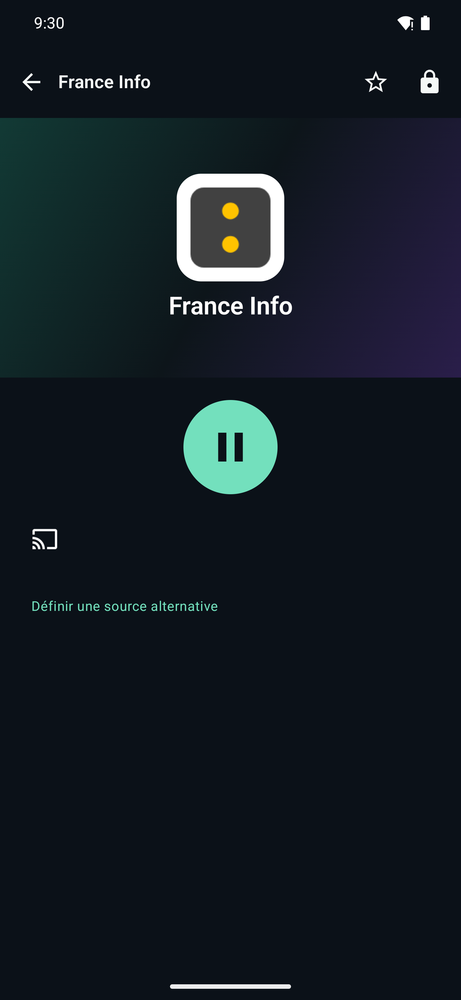
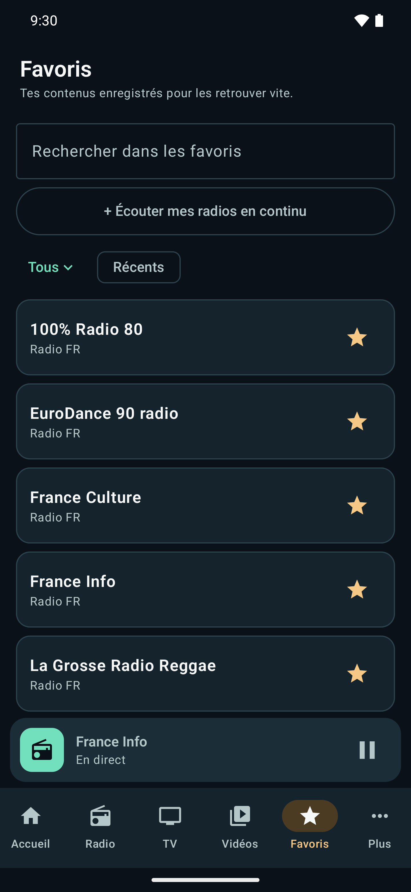
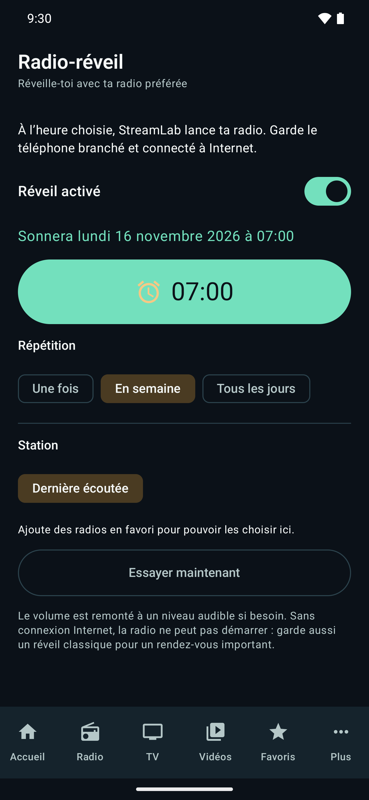
</p>
<p align="center"><sub>Stations by country · playback · favourites (with the mini player at the bottom) · radio alarm</sub></p>

### 📺 TV
- **Your channels, sorted by country and language** — sorting reads the broadcast feed ("@FR") before the owner's name, and never mistakes "SD/HD" for a country.
- **Full-screen player** with a "live" banner, **now / next** (XMLTV guide), swipe to zap and a channel list.
- **Channel logos** in every list (phone and car screen), read from your playlist; white logos get a dark tile.
- **Channel check**: one button tests the streams and flags those that do not respond.
- **Multiview**: **2 to 4 channels at once**, as a mosaic, with sound on the one you pick.
- **Picture-in-picture (PiP)**: TV keeps playing in a small window when you leave the app.
- **Playback speed** (0.75× to 2×) for videos.
- **Add your channels**: M3U playlist (link or file), Xtream Codes provider, single channel, XMLTV guide.
- **Backup sources** per channel, as for radio.

<p align="center">
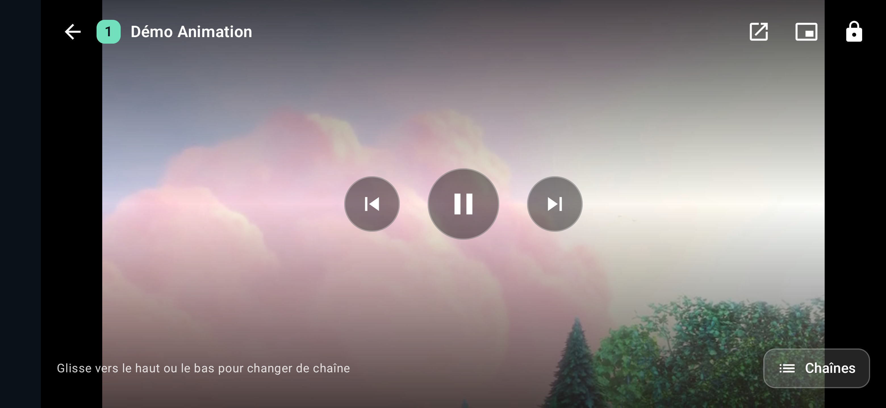
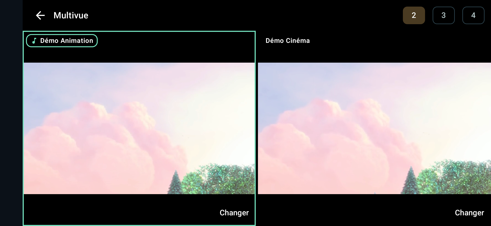
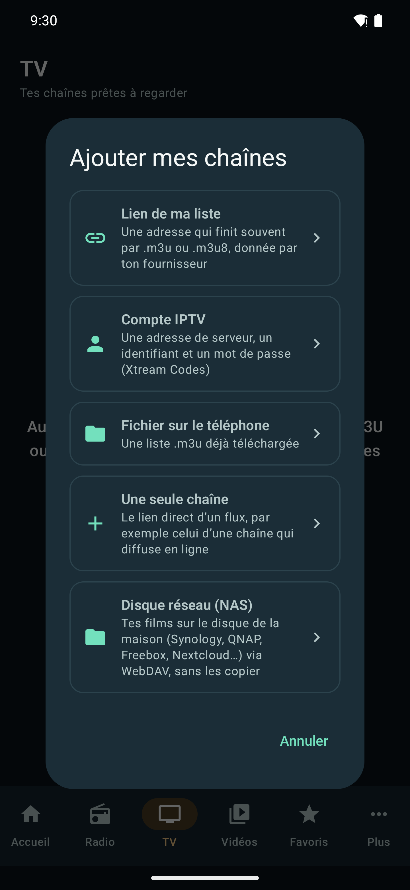
</p>
<p align="center"><sub>Full screen · multiview · add your channels. The demo pictures come from the free film <i>Big Buck Bunny</i> (CC BY 3.0).</sub></p>

### 🎬 Videos and network drive
- **Home network drive (WebDAV)**: Synology, QNAP, Freebox, Nextcloud… Browse your folders and play a film **without copying it** to the phone.
- **Files on the phone** and **"Continue watching"** at the exact point where you stopped.
- **Open in another player** (VLC, MX Player…) in one tap.

<p align="center">
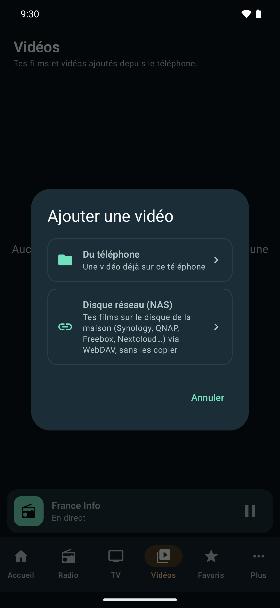
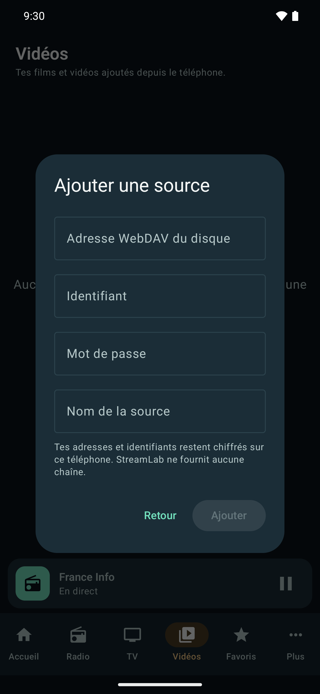
</p>
<p align="center"><sub>Choose between the phone and the network drive · credentials encrypted on the device</sub></p>

### 📡 On the living-room TV
- **Google Cast**: send radio, a channel or a video from the phone to your TV / Chromecast.
- Videos stored on the phone are served locally, protected by a one-time token.

### 🚗 Android Auto
- A clear menu on the road: **Radio by country, Favourites, Recent, TV, Sources**.
- **Next / previous station** from the steering wheel, voice control, artwork and logos.
- Short, readable error messages (never technical codes on screen).
- Passengers edition: video while parked, sound only while driving, automatic return to full screen when parked ([see below](#android-auto)).

### 🧭 Handy
- **Favourites** and **Recent** everywhere.
- **Share with a friend**: your favourite stations and playlists, by **QR code** (never any login or password in the code).
- **Kids mode**: the app is limited to your favourites, protected by a parent PIN.
- **Data saver**: on 4G/5G, video drops to 480p (about 3 times less data); full quality on Wi-Fi.
- Clear **offline mode**: a simple message instead of an error screen.
- **First-launch tips**, discreet, shown once.
- **Web services**: shortcuts to the official apps (Netflix, YouTube, Prime Video, Disney+, Twitch, Plex, Jellyfin, Emby). StreamLab **neither embeds nor bypasses** their player or their protections.

<p align="center">
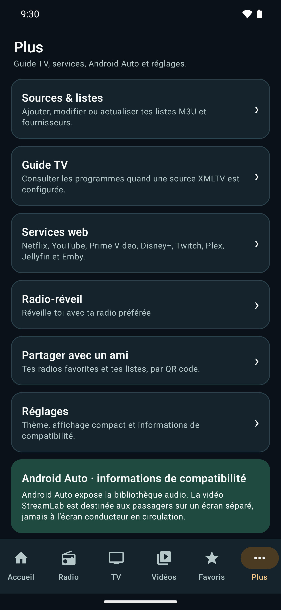
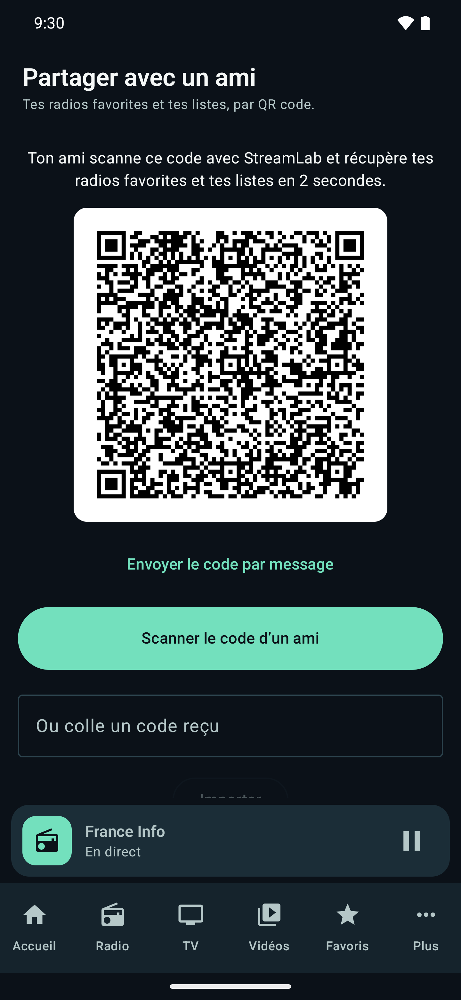
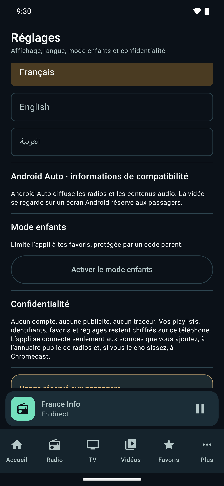
</p>
<p align="center"><sub>"More" menu · QR code sharing · kids mode and privacy</sub></p>

### 🎨 Interface and languages
- Dark **Cinema** theme, **light** or **system**; optional compact list.
- Sharp vector icons, station logos, elegant monograms when a station has no logo.
- **Three complete languages**: French, English, **Arabic (right to left)** — or the system language. You choose it on first launch and can change it at any time in the settings.
- Accessibility: screen-reader descriptions, large touch targets.

<p align="center">
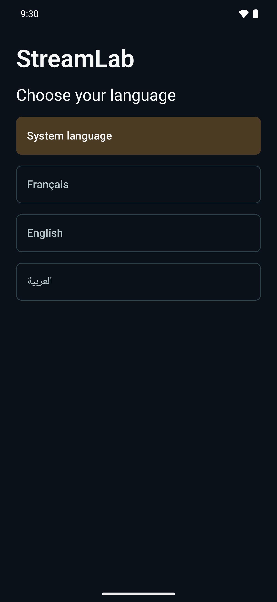
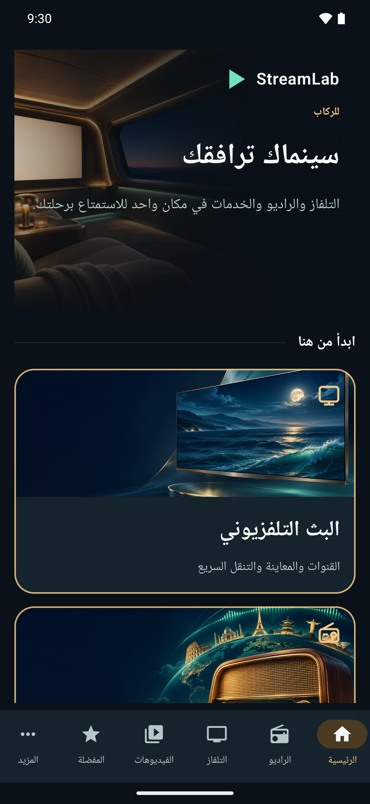
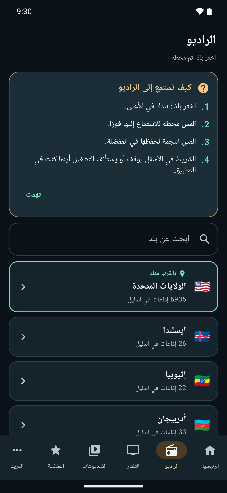
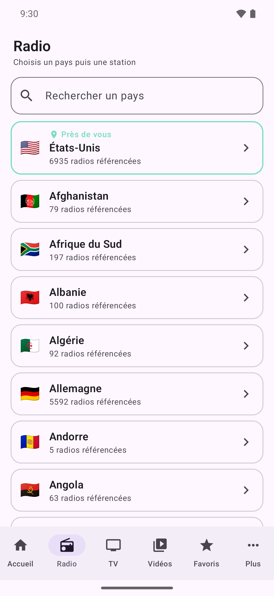
</p>
<p align="center"><sub>Language choice on first launch · the app in Arabic, right to left · light theme</sub></p>

---

## Android Auto

### Google Play edition
Nothing to do: plug in your phone and StreamLab appears among Android Auto's media apps.

### Passengers edition (video while parked)
Requirements: **Android 15 or later** and a touch screen in the car.

1. Install the `parkedDebug` APK (shown as **StreamLab Passagers**). It is the complete app: no need to install the Play edition too.
2. On the phone: **Android Auto → Settings** → tap **"Version"** 10 times to turn on developer mode.
3. ⋮ menu → **Developer settings** → tick **"Unknown sources"**.
4. Plug the phone in again. With the car parked, open the app grid (the 9 dots) and tap **"StreamLab Passagers"**,
   then **"TV en direct"**: the channel shows; the **"Plein écran"** button (or a second tap on the channel) makes it full screen.

**While parked** the channel plays full screen; **while driving** Android Auto closes the picture and **the sound goes on**
(with controls on the media screen and the steering wheel); **parked again**, the same channel comes back full screen.
In the car screen's settings, **"Keep the screen on"** stops the screen from going to sleep during video.

<p align="center">
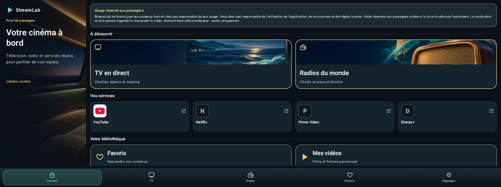
</p>
<p align="center">
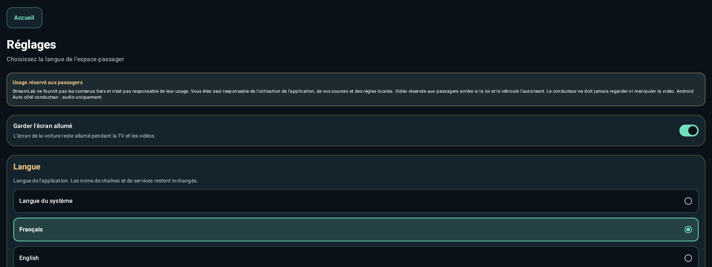
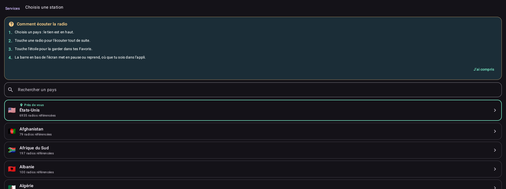
</p>
<p align="center"><sub>StreamLab Passengers' car screen: home, settings ("Keep the screen on"), radio.
Captured on a 1920×720 secondary display of the Android emulator, which simulates the car screen.</sub></p>

---

## Install

**Google Play** — *coming soon*.

**StreamLab Passengers (APK)** — the complete app + the car screen: [⬇️ download the latest version](https://github.com/projetperso78/StreamLab/releases/latest).
Open the file on your phone to install it, then follow the [Android Auto](#android-auto) steps for the car screen.

**From source** (JDK 17, Android SDK 36):

```bash
./gradlew :app:assembleDebug          # standard edition
./gradlew :app:assembleParkedDebug    # Passengers edition (video while parked)
```

There is no key and no secret in this repository: release signing is read only from environment variables.

---

## Quality

- **Architecture**: Kotlin, Jetpack Compose, Media3 (ExoPlayer, `MediaLibraryService`, `MediaController`), Room, OkHttp.
- **Tests**: 133 unit tests and 90 instrumented tests (navigation, playback, Android Auto, Cast, multiview, network drive, radio, failover…).
- **Robustness**: more than 75,000 random actions (*monkey* stress test) on the debug and release builds, with no crash.
- **Release build**: shrunk and obfuscated code (R8), lint clean on every variant.
- **Security**:
  - sources and credentials **encrypted on the device** (Android Keystore, AES-GCM);
  - **HTTPS** network; local-network addresses are refused except the network drive you added;
  - hardened WebDAV parsing (DTD/entities refused);
  - no credentials in the logs;
  - Android data backup turned off.

---

## Privacy

- **No account**, **no ads**, **no analytics**.
- Your playlists, favourites, history and settings **stay on your phone**.
- Network connections only to: the sources you add, the Radio Browser directory, Google Cast and the Google Play services QR scanner (only when you use them).

Full policy (French and English): [docs/play/POLITIQUE_CONFIDENTIALITE.md](docs/play/POLITIQUE_CONFIDENTIALITE.md).

---

## Licence and ownership

© 2026 Younes Ajbilou — **All rights reserved.**

✅ **Allowed**: viewing this repository, downloading it, building it and installing the app on your own devices,
for **personal, private and non-commercial** use.

⛔ **Not allowed without written permission**: redistributing or publishing the app (or a modified version), including
on an app store, selling it, reusing the code, the **StreamLab** name, the icon, the interface or the screenshots
in another project, or using this repository to train an AI. This is not an open-source licence.

> ⚠️ **Disclaimer.** The app is provided **"as is", without any warranty**.
> If you download, build, install or use it, you do so **entirely at your own risk and under your own
> responsibility**. To the fullest extent permitted by law, the author is **in no way liable for what you do
> with it** or its consequences: the sources and content you add and their legality, use in a car
> (the driver alone is responsible for driving; the Passengers edition is for passengers and parked cars only),
> any damage, data loss, mobile data charges, or any version modified by others.

See [LICENSE](LICENSE) and [NOTICE](NOTICE.md).

Third-party service names and logos (Netflix, YouTube, Prime Video, Disney+, Android Auto, Google Cast…)
belong to their respective owners. StreamLab is not affiliated with any of them.

Contact: contactstreamlab@gmail.com
