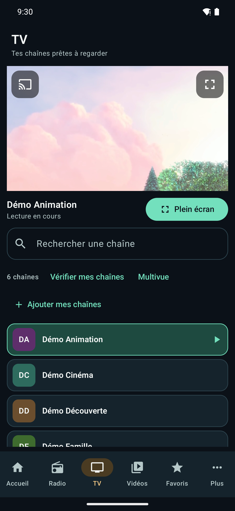
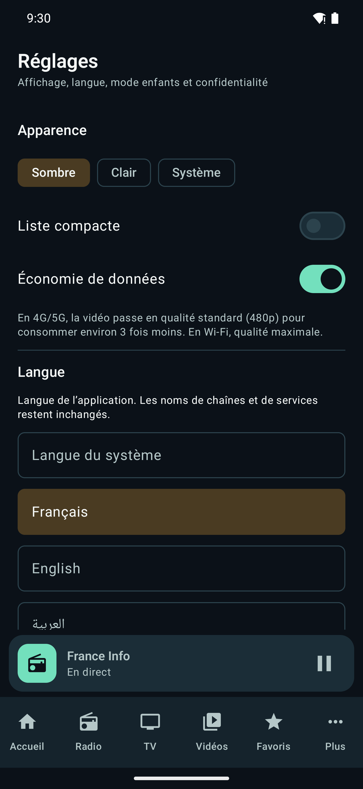
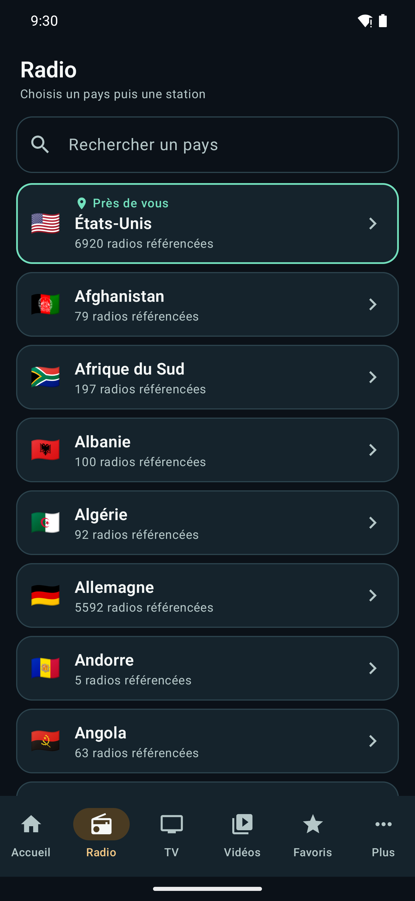
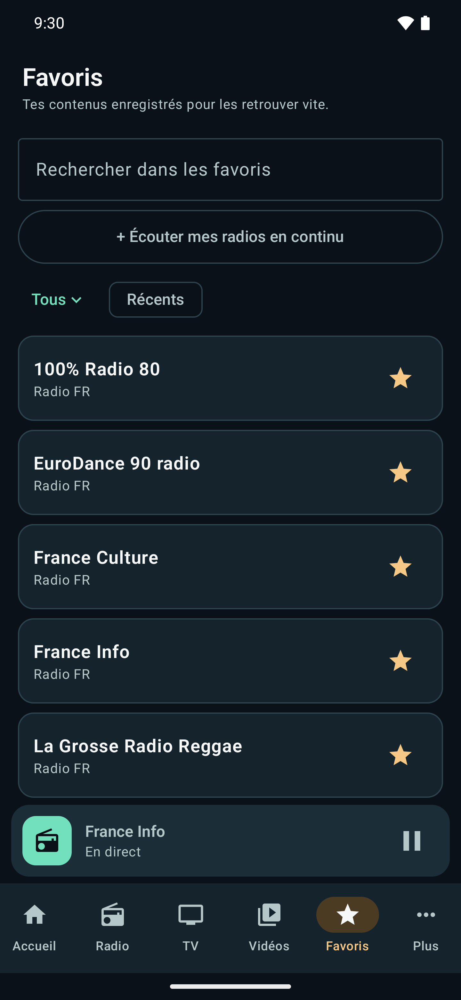
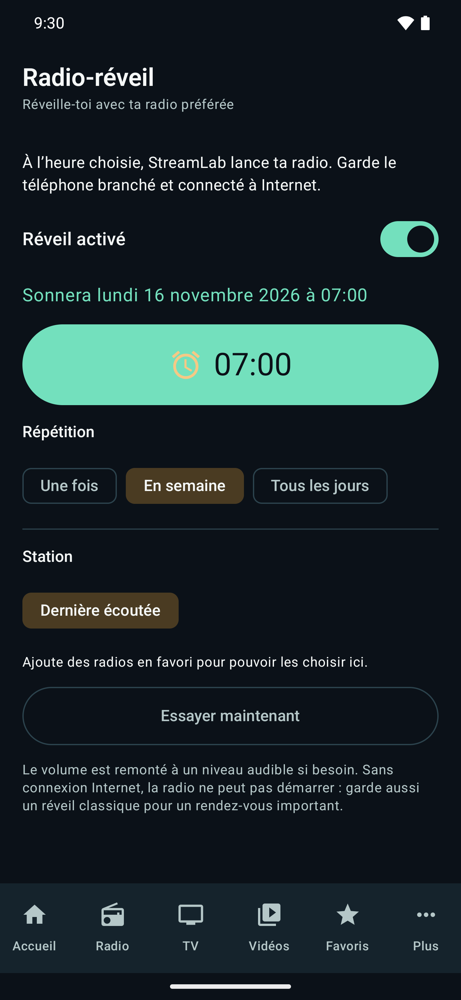
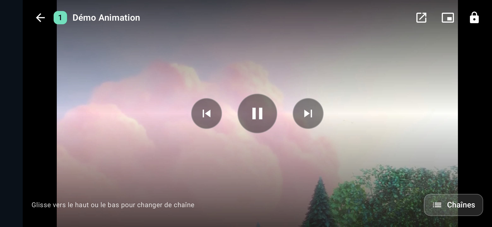
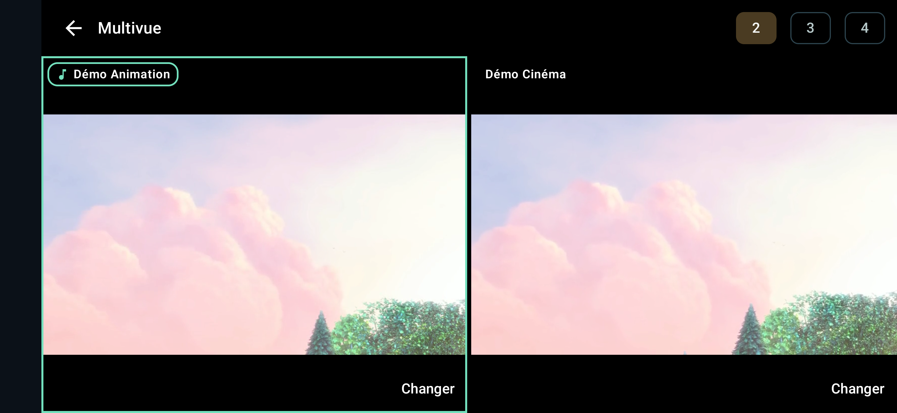
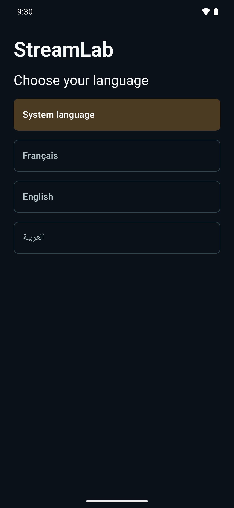
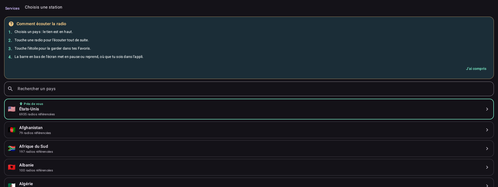

<div align="center">

**Français** · [English](README.en.md) · [العربية](README.ar.md)

# StreamLab

**Radio du monde entier, tes chaînes TV et tes vidéos — sur ton téléphone, ta TV et dans la voiture.**

Application Android native (Kotlin · Jetpack Compose · Media3), sans compte, sans publicité, sans pistage.


<a href="https://github.com/projetperso78/StreamLab/releases/latest"><b>⬇️ Télécharger Passagers (APK)</b></a> ·
<a href="#installer">Installer</a> ·
<a href="#ce-que-fait-streamlab-de-a-%C3%A0-z">Fonctions</a> ·
<a href="#android-auto">Android Auto</a> ·
<a href="#confidentialit%C3%A9">Confidentialité</a> ·
<a href="#licence-et-propri%C3%A9t%C3%A9">Licence</a>

<br>





</div>

---

## Pourquoi StreamLab ?

La plupart des lecteurs IPTV ou radio sont soit des usines à gaz, soit truffés de publicités et de traqueurs.
StreamLab fait le choix inverse : **une seule appli claire** pour écouter la radio de n'importe quel pays,
regarder **tes propres** chaînes et vidéos, et retrouver tout ça **dans la voiture** — sans créer de compte
et sans que rien ne quitte ton téléphone.

> StreamLab **ne fournit aucune chaîne ni aucun contenu**. Tu ajoutes tes propres sources (listes M3U,
> fournisseur Xtream, guide XMLTV, disque réseau) et tu restes responsable d'en avoir le droit.
> Les radios proviennent de l'annuaire public et ouvert [Radio Browser](https://www.radio-browser.info).

---

## Deux éditions

> **StreamLab Passagers = toute l'appli légale + l'écran voiture.**
> Même code, mêmes fonctions, mêmes réglages et mêmes langues que l'édition Google Play,
> avec en plus l'écran plein format sur la voiture à l'arrêt. Le code des deux éditions est dans ce dépôt
> (`app/src/main` pour l'appli commune, `app/src/parkedDebug` pour l'écran voiture).

| | **StreamLab** (Google Play) | **StreamLab Passagers** (édition personnelle) |
|---|---|---|
| Toute l'appli : radio, TV, multivue, vidéos, disque réseau, Cast, favoris, réveil… | ✅ | ✅ identique |
| Android Auto — radio et son des chaînes (écran multimédia) | ✅ | ✅ |
| S'installe seule (aucune autre appli requise) | ✅ | ✅ |
| Android Auto — **vidéo à l'arrêt** (voiture garée) | — | ✅ |
| En roulant | audio uniquement | Android Auto ferme l'image, **le son continue** |
| De nouveau à l'arrêt | — | **la même chaîne revient en plein écran** |
| Écran de la voiture maintenu allumé (option) | — | ✅ |
| Distribution | Google Play — *bientôt* | non distribuée sur les boutiques |

La vidéo sur l'écran de la voiture s'appuie sur la catégorie officielle **« applis à l'arrêt »** d'Android Auto
(Android 15 et plus) : c'est Android Auto lui-même qui coupe l'image dès que la voiture roule.
Aucune règle de sécurité de conduite n'est contournée.

> 📲 **Google Play** : la version publique arrive bientôt. Le lien sera ajouté ici.

---

## Ce que fait StreamLab, de A à Z

### 📻 Radio
- **Toutes les radios du monde, rangées par pays** — plus de 40 000 stations (annuaire Radio Browser), avec drapeaux et nombre de stations.
- **« Près de vous »** : ton pays est proposé en premier (détecté sur l'appareil, **sans GPS ni permission de localisation**).
- **« Les plus aimées »** et **« Tendances »** dans chaque pays, recherche instantanée.
- **Noms propres** : « RADIO-XYZ 128k AAC (geo-blocked) » devient « Radio XYZ » ; doublons fusionnés ; genres lisibles.
- **Titre en cours** affiché (artiste – titre) quand la radio l'envoie.
- **Favoris en une touche** (étoile), et **« Écouter mes radios en continu »** : tes favorites s'enchaînent comme une playlist.
- **Sources de secours** : si une radio tombe, StreamLab essaie automatiquement jusqu'à **3 adresses** avant de passer à la suivante.
- **Pas de publicité en boucle** : le lecteur ne recoupe plus les longs flux (la pub d'ouverture ne revient plus toutes les 30 s).
- **Radio-réveil** : à l'heure choisie, une fois, en semaine ou tous les jours, avec ta station préférée.
- **Commande vocale** : « Ok Google, mets RTL » trouve la meilleure correspondance, même si elle n'est pas dans tes favoris.

<p align="center">




</p>
<p align="center"><sub>Radios par pays · lecture · favoris (avec le mini-lecteur en bas) · radio-réveil</sub></p>

### 📺 TV
- **Tes chaînes, rangées par pays et par langue** — le classement lit le flux de diffusion (« @FR ») avant le nom du propriétaire, et ne confond pas « SD/HD » avec un pays.
- **Lecteur plein écran** avec bandeau « en direct », **programme en cours / à suivre** (guide XMLTV), zapping au doigt et liste des chaînes.
- **Vérification des chaînes** : un bouton teste les flux et signale ceux qui ne répondent pas.
- **Multivue** : **2 à 4 chaînes en même temps**, en mosaïque, le son sur celle que tu choisis.
- **Image dans l'image (PiP)** : la TV continue dans une petite fenêtre quand tu quittes l'appli.
- **Vitesse de lecture** (0,75× à 2×) pour les vidéos.
- **Ajouter ses chaînes** : liste M3U (adresse ou fichier), fournisseur Xtream Codes, chaîne unique, guide XMLTV.
- **Sources de secours** par chaîne, comme pour la radio.

<p align="center">



</p>
<p align="center"><sub>Plein écran · multivue · ajouter ses chaînes. Les images de démonstration viennent du film libre <i>Big Buck Bunny</i> (CC BY 3.0).</sub></p>

### 🎬 Vidéos et disque réseau
- **Disque réseau à la maison (WebDAV)** : Synology, QNAP, Freebox, Nextcloud… Parcours tes dossiers et lance un film **sans le copier** sur le téléphone.
- **Fichiers du téléphone** et **« Continuer à regarder »** à l'endroit exact où tu t'étais arrêté.
- **Ouvrir dans un autre lecteur** (VLC, MX Player…) en un geste.

<p align="center">


</p>
<p align="center"><sub>Choisir entre le téléphone et le disque réseau · identifiants chiffrés sur l'appareil</sub></p>

### 📡 Sur la TV du salon
- **Google Cast** : envoie la radio, une chaîne ou une vidéo du téléphone vers ta TV / Chromecast.
- Les vidéos stockées sur le téléphone sont servies localement, protégées par un jeton à usage unique.

### 🚗 Android Auto
- Arborescence claire au volant : **Radio par pays, Favoris, Récents, TV, Sources**.
- **Station suivante / précédente** depuis le volant, commande vocale, pochettes et logos.
- Messages d'erreur courts et lisibles (jamais de codes techniques à l'écran).
- Édition Passagers : vidéo à l'arrêt, son seul en roulant, retour automatique en plein écran à l'arrêt ([voir plus bas](#android-auto)).

### 🧭 Pratique
- **Favoris** et **Récents** partout.
- **Partager avec un ami** : tes radios favorites et tes listes, par **QR code** (jamais d'identifiants ni de mot de passe dans le code).
- **Mode enfants** : l'appli se limite à tes favoris, protégée par un code parent.
- **Économie de données** : en 4G/5G, la vidéo passe en 480p (environ 3 fois moins de données) ; qualité maximale en Wi-Fi.
- **Mode hors ligne** clair : un message simple au lieu d'un écran d'erreur.
- **Conseils au premier lancement**, discrets, une seule fois.
- **Services web** : raccourcis vers les applis officielles (Netflix, YouTube, Prime Video, Disney+, Twitch, Plex, Jellyfin, Emby). StreamLab **n'intègre ni ne contourne** leur lecteur ni leurs protections.

<p align="center">


</p>
<p align="center"><sub>Menu « Plus » · partage par QR code · mode enfants et confidentialité</sub></p>

### 🎨 Interface et langues
- Thème **Cinéma** sombre, **clair** ou **système** ; liste compacte en option.
- Icônes vectorielles nettes, logos des stations, monogrammes élégants quand une station n'a pas de logo.
- **Trois langues complètes** : français, anglais, **arabe (de droite à gauche)** — ou la langue du système. La langue se choisit au premier lancement et se change à tout moment dans les réglages.
- Accessibilité : descriptions pour les lecteurs d'écran, grandes zones tactiles.

<p align="center">



</p>
<p align="center"><sub>Choix de la langue au premier lancement · l'appli en arabe, de droite à gauche · thème clair</sub></p>

---

## Android Auto

### Édition Google Play
Rien à faire : branche ton téléphone, StreamLab apparaît dans les applis multimédias d'Android Auto.

### Édition Passagers (vidéo à l'arrêt)
Prérequis : **Android 15 ou plus** et un écran de voiture tactile.

1. Installe l'APK `parkedDebug` (nom affiché : **StreamLab Passagers**). C'est l'appli complète : pas besoin d'installer aussi la version Play.
2. Sur le téléphone : **Android Auto → Paramètres** → touche 10 fois **« Version »** pour activer le mode développeur.
3. Menu ⋮ → **Paramètres pour les développeurs** → coche **« Sources inconnues »**.
4. Rebranche le téléphone : l'appli apparaît dans le lanceur de la voiture.

**À l'arrêt** la chaîne s'affiche en plein écran ; **en roulant** Android Auto ferme l'image et **le son continue**
(avec les commandes sur l'écran multimédia et au volant) ; **de nouveau à l'arrêt**, la même chaîne revient en plein écran.
Dans les réglages de l'écran voiture, l'option **« Garder l'écran allumé »** évite la mise en veille pendant la vidéo.

<p align="center">

</p>
<p align="center">


</p>
<p align="center"><sub>L'écran voiture de StreamLab Passagers : accueil, réglages (« Garder l'écran allumé »), radio.
Captures faites sur un écran secondaire de 1920×720 de l'émulateur Android, qui simule l'écran de la voiture.</sub></p>

---

## Installer

**Google Play** — *bientôt*.

**StreamLab Passagers (APK)** — l'appli complète + l'écran voiture : [⬇️ télécharger la dernière version](https://github.com/projetperso78/StreamLab/releases/latest).
Ouvre le fichier sur ton téléphone pour l'installer, puis suis les étapes de la section [Android Auto](#android-auto) pour l'écran voiture.

**Depuis les sources** (JDK 17, Android SDK 36) :

```bash
./gradlew :app:assembleDebug          # édition standard
./gradlew :app:assembleParkedDebug    # édition Passagers (vidéo à l'arrêt)
```

Aucune clé ni aucun secret n'est présent dans ce dépôt : la signature de publication se lit uniquement
depuis des variables d'environnement.

---

## Qualité

- **Architecture** : Kotlin, Jetpack Compose, Media3 (ExoPlayer, `MediaLibraryService`, `MediaController`), Room, OkHttp.
- **Tests** : 132 tests unitaires et 90 tests instrumentés (navigation, lecture, Android Auto, Cast, multivue, disque réseau, radio, failover…).
- **Robustesse** : plus de 75 000 actions aléatoires (stress test *monkey*) sur les versions debug et release, sans plantage.
- **Version publiée** : code réduit et obfusqué (R8), lint sans erreur sur toutes les variantes.
- **Sécurité** :
  - sources et identifiants **chiffrés sur l'appareil** (Android Keystore, AES-GCM) ;
  - réseau en **HTTPS** ; les adresses du réseau local sont refusées sauf le disque réseau que tu as ajouté ;
  - réponses WebDAV durcies (DTD/entités refusées) ;
  - aucun identifiant dans les journaux ;
  - sauvegarde Android des données désactivée.

---

## Confidentialité

- **Aucun compte**, **aucune publicité**, **aucun outil de mesure d'audience**.
- Tes listes, favoris, historique et réglages **restent sur ton téléphone**.
- Connexions réseau uniquement vers : les sources que tu ajoutes, l'annuaire Radio Browser, Google Cast et le scanner QR de Google Play services (seulement quand tu les utilises).

Politique complète : [docs/play/POLITIQUE_CONFIDENTIALITE.md](docs/play/POLITIQUE_CONFIDENTIALITE.md).

---

## Licence et propriété

© 2026 Younes Ajbilou — **Tous droits réservés.**

✅ **Autorisé** : consulter ce dépôt, le télécharger, le compiler et installer l'appli sur tes propres appareils,
pour un usage **personnel, privé et non commercial**.

⛔ **Interdit sans accord écrit** : redistribuer ou publier l'appli (ou une version modifiée), notamment sur une
boutique d'applications, la vendre, réutiliser le code, le nom **StreamLab**, l'icône, l'interface ou les captures
dans un autre projet, ou se servir de ce dépôt pour entraîner une IA. Ce n'est pas une licence open source.

> ⚠️ **Décharge de responsabilité.** L'appli est fournie **« en l'état », sans aucune garantie**.
> Si tu la télécharges, la compiles, l'installes ou l'utilises, tu le fais **à tes seuls risques et sous ta seule
> responsabilité**. Dans toute la mesure permise par la loi, l'auteur **n'est en aucun cas responsable de ce que
> tu en fais** ni de ses conséquences : les sources et contenus que tu ajoutes et leur légalité, l'usage en voiture
> (le conducteur reste seul responsable de sa conduite ; l'édition Passagers est réservée aux passagers et à la
> voiture à l'arrêt), les dommages, pertes de données, frais de données mobiles, ou toute version modifiée par un tiers.

Voir [LICENSE](LICENSE) et [NOTICE](NOTICE.md).

Les noms et logos de services tiers (Netflix, YouTube, Prime Video, Disney+, Android Auto, Google Cast…)
appartiennent à leurs propriétaires respectifs. StreamLab n'est affilié à aucun d'eux.

Contact : contactstreamlab@gmail.com
